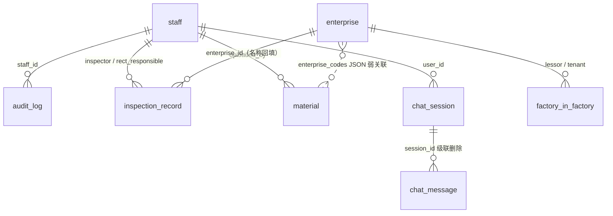

# SQL 表结构

> 适用状态：2026-10-04。PostgreSQL 16，库/用户默认 `rag`，异步驱动 asyncpg。
> 表定义源：[app/db/models.py](../app/db/models.py)；迁移脚本：[app/alembic/versions/](../app/alembic/versions/)（17 个，线性链）。
> 迁移在 rag-api 启动时自动执行（`alembic upgrade head`）。

共 **8 张表**：staff、enterprise、material、inspection_record、factory_in_factory、audit_log、chat_session、chat_message。

---

## 1. 关系总览

- 物理外键除 `chat_message.session_id` 为 **ON DELETE CASCADE** 外，其余均为默认 NO ACTION。
- 隐患表与企业的**业务关联键是 `enterprise_code` + `enterprise_name`（Excel 快照原文）**，`enterprise_id` 仅在能按名匹配时回填。
- `material.enterprise_codes` 是 JSON 数组字符串（企业信用代码），无外键约束。
- 企业有关联隐患时应用层禁止删除。

---

## 2. staff — 监管人员（凭证 + 档案 + 权限合一）

无独立角色表；`is_admin` 只放行账号管理接口，业务数据全员可查。

| 字段 | 类型 | 空 | 说明 |
|---|---|---|---|
| id | int PK | 否 | |
| username | varchar | 否 | 登录名，唯一索引 |
| password_hash | varchar | 否 | bcrypt |
| is_active | bool | 否 | 默认 true；停用不物理删除 |
| is_admin | bool | 否 | 默认 false |
| name | varchar | 否 | 姓名 |
| department / position / phone | varchar | 是 | 部门 / 职务 / 电话 |
| last_login_at | datetime | 是 | 最近登录 |
| created_at | datetime | 否 | |

种子账号 admin/admin123（[seed.py](../app/db/seed.py)，幂等）。

## 3. enterprise — 企业主数据

| 字段 | 类型 | 空 | 说明 |
|---|---|---|---|
| id | int PK | 否 | |
| name | varchar | 否 | 企业名称 |
| code | varchar | 是 | 统一社会信用代码（18 位、9 开头），**唯一索引**；手工新建必填、导入可空（允许多个 NULL） |
| industry / region / address | varchar | 是 | 行业（自由文本，常见值见下）/ 区域园区 / 地址 |
| legal_person | varchar | 是 | 法定代表人 |
| person_in_charge | varchar | 是 | 企业负责人 |
| safety_officer | varchar | 是 | 安全员 |
| legal_person_phone | varchar | 是 | 法人电话 |
| person_in_charge_phone | varchar | 是 | 负责人电话 |
| safety_officer_phone | varchar | 是 | 安全员电话 |
| **enterprise_category** | **text[]** | 是 | 多标签：劳密 / 厂中厂出租 / 厂中厂承租 / 小场所 / 其他（全库唯一真数组列） |
| asset_attribute | varchar | 是 | 韩资 / 台资 / 其他 |
| enterprise_scale | varchar | 是 | 规上 / 规下 |
| employee_count / annual_output_value | int | 是 | 职工人数 / 年产值（万元） |
| fire_level | varchar | 是 | 二级 / 三级 / 重点单位 |
| confined_space | varchar | 是 | 有限空间标签：地上 / 地下 |
| confined_space_count | varchar | 是 | 有限空间数量（数字字符串） |
| confined_space_type | varchar | 是 | 类型详述 |
| confined_space_workers | varchar | 是 | 作业人数 |
| confined_space_hazards | varchar | 是 | 危险因素 |
| confined_space_op_subject | varchar | 是 | 作业主体（自行/发包等） |
| confined_space_op_cycle | varchar | 是 | 作业周期 |
| confined_space_fixed_workers | varchar | 是 | 作业人员是否固定（是/否） |
| hazchem_used_names | varchar | 是 | 使用危化品名称（多值"、"拼接） |
| hazchem_names | varchar | 是 | 危化品名称（台账） |
| hazchem_op_subject | varchar | 是 | 自行 / 发包 / 自行和发包 |
| hazchem_major_hazard | varchar | 是 | 是否重大危险源 |
| hazchem_state | varchar | 是 | 液态 / 固态 / 气态（可多值） |
| hazchem_op_cycle | varchar | 是 | 作业周期（月/年） |
| hazchem_usage | varchar | 是 | 生产 / 实验 / 其他 |
| hazchem_annual_usage | varchar | 是 | 年度使用量 |
| hazchem_storage | varchar | 是 | 储罐 / 危化品库 / 中间库 / 防爆柜 |
| hazchem_reserve | varchar | 是 | 储量 |
| hazchem_fixed_workers | varchar | 是 | 作业人员是否固定 |
| has_natural_gas | bool | 否 | 天然气，默认 false |
| is_injection_molding | bool | 否 | 注塑企业 |
| has_dormitory | bool | 否 | 宿舍 |
| has_hazardous_chemicals | bool | 否 | 危化品 |
| has_hazardous_waste | bool | 否 | 危废品 |
| involves_dust_explosion | bool | 否 | 粉尘爆炸 |
| is_new_energy_welding | bool | 否 | 新能源电焊 |
| has_large_storage_tank | bool | 否 | 大型储罐（server_default false） |
| out_of_park | bool | 否 | 园区外复核标记（true=待人工复核删除） |
| out_of_park_note | varchar(64) | 是 | 判定依据（光电园/韩资园/步凤镇等） |
| **extra** | **jsonb** | 是 | 长尾键值对，值只允许字符串或字符串数组 |
| created_at / updated_at | datetime | 否 | |

`extra` 当前仍在使用的键：`国民经济分类`、`街道`、`所在县区`、`联系电话`、`粉尘种类`、`有限空间`（非地上/地下的通用原文）、`涉及大型储罐`（描述文本，bool 列只表是否）、`厂房编号`（企业名末尾 `#9#10#` 剥离而来）；自定义导入列可用任意 `extra:键名` 落键。有限空间 4 字段、危化品 11 字段、厂中厂角色均已在历次迁移中从 extra 固化为正式列。

枚举全部为**应用层校验，库内无 CHECK**。industry 无强校验（纺织/机械/建材/轻工/化工/汽车/电子/物流/食品等均可能出现）。

## 4. material — 材料登记（一行一份文件）

切片与向量存 Qdrant，本表只存登记元数据。

| 字段 | 类型 | 空 | 说明 |
|---|---|---|---|
| id | int PK | 否 | |
| uid | varchar | 否 | UUID，材料稳定身份（写入 Qdrant payload 的 material_id） |
| filename / storage_path | varchar | 否 | 文件名 / 本地路径（无文件时为 ""） |
| file_hash | varchar | 是 | sha256 去重 |
| mime_type / source_format | varchar | 是 | MIME / pdf、docx 等 |
| page_count | int | 是 | 页数 |
| uploaded_by | int FK→staff | 是 | 上传人 |
| qdrant_collection | varchar | 是 | 所在集合 |
| status | varchar | 否 | pending → indexing → indexed / failed |
| indexed_at | datetime | 是 | 索引完成时间 |
| enterprise_codes | varchar | 是 | **实际存 JSON 数组字符串**（如 `["CODE1"]`），非 text[]；元素为大写去重信用代码 |
| scope_industry / scope_region | varchar | 是 | 范围形态 B：行业 / 区域定向 |
| scope_sync_pending | bool | 否 | 范围同步脏标记 |
| created_at | datetime | 否 | |

## 5. inspection_record — 巡查隐患（一行一条）

唯一约束 `uq_inspection_hazard_identity(inspection_batch, enterprise_name, hazard_index)`（导入幂等身份键）；inspection_batch / enterprise_code / enterprise_name / status 有索引。

| 字段 | 类型 | 空 | 说明 |
|---|---|---|---|
| id | int PK | 否 | |
| inspection_batch | varchar | 否 | 巡查批次（如 2026-09），索引 |
| enterprise_code / enterprise_name | varchar | 是 | 业务关联键（Excel 原文），均索引 |
| enterprise_id | int FK→enterprise | 是 | 名称匹配后回填的数据指针 |
| hazard_index | int | 是 | 同批次同企业内隐患序号 |
| hazard_count_total | int | 是 | 该次检查隐患总数 |
| title / hazard_category | varchar | 是 | 标题 / 隐患类别 |
| hazard_level | varchar | 是 | **low / medium / high**（Excel 导入可空、Agent 可后补；API 新建默认 low） |
| hazard_description | text | 否 | 隐患描述（默认 ""） |
| inspection_date | date | 是 | 巡查日期 |
| location / region / industry | varchar | 是 | 地点 / 园区镇街 / 行业 |
| inspectors | varchar | 是 | 检查人（顿号分隔 Excel 原文） |
| inspector_user_id | int FK→staff | 是 | 检查人系统指针 |
| rect_responsible_name | varchar | 是 | 整改责任人（原文） |
| rect_responsible_user_id | int FK→staff | 是 | 责任人系统指针 |
| rect_deadline | date | 是 | 整改期限 |
| rect_completed_at | datetime | 是 | 实际完成时间 |
| status | varchar | 否 | **open → rectifying → closed**（单向），默认 open，索引 |
| remark | varchar | 是 | |
| created_at | datetime | 否 | |

状态中文映射（导入）：已整改/整改完成/已闭环→closed，整改中→rectifying，未整改/待整改/未闭环→open。

## 6. factory_in_factory — 厂中厂出租-承租关系（一行一对）

| 字段 | 类型 | 空 | 说明 |
|---|---|---|---|
| id | int PK | 否 | |
| inspection_batch | varchar | 否 | 批次（如 2026-厂中厂消防），索引 |
| region / address | varchar | 是 | 县（市、区）/ 具体地址 |
| lessor_enterprise_id | int FK→enterprise | 是 | 出租方指针（索引） |
| lessor_name | varchar | 是 | 出租方名称原文，索引 |
| lessor_contact_person / lessor_contact_phone | varchar | 是 | 出租方联系人 / 电话 |
| lessor_use_area | varchar | 是 | 使用面积㎡或"纯出租" |
| lessor_hazard_description / lessor_rect_status | varchar | 是 | 出租方隐患（顿号拼接）/ 整改情况 |
| tenant_enterprise_id | int FK→enterprise | 是 | 承租方指针（索引） |
| tenant_name | varchar | 是 | 承租单位名称原文，索引 |
| tenant_area | float | 是 | 承租建筑面积㎡ |
| tenant_contact_person / tenant_contact_phone | varchar | 是 | 承租方联系人 / 电话 |
| agreement_signed | bool | 是 | 是否签消防安全协议（可空三态） |
| tenant_hazard_description / tenant_rect_status | varchar | 是 | 承租方隐患 / 整改情况 |
| site_category | varchar | 是 | 丙类 / 丁类 / 厂中厂 |
| inspection_date | date | 是 | 排查时间 |
| inspectors / rect_supervisor | varchar | 是 | 排查人员 / 督改人员 |
| remark | text | 是 | 原始备注全文 |
| created_at / updated_at | datetime | 否 | |

筛选时企业名口径统一为 `COALESCE(enterprise.name, 快照名)`。

## 7. audit_log — 审计日志（只追加）

| 字段 | 类型 | 空 | 说明 |
|---|---|---|---|
| id | int PK | 否 | |
| staff_id | int FK→staff | 是 | 操作人（失败登录可空） |
| action | varchar | 否 | 动作标识 |
| resource_type / resource_id | varchar | 是 | 资源类型 / ID |
| request_payload | text | 是 | 提交字段 JSON |
| ip_address | varchar | 是 | |
| latency_ms | int | 是 | 耗时毫秒 |
| status | varchar | 否 | success / failed |
| error_message | text | 是 | |
| created_at | datetime | 否 | |

action 取值：`auth.login` / `auth.change_password`、`admin.staff.*`、`enterprise.create/update/delete`、`inspection.*`（含 `inspection.status.{open|rectifying|closed}`）、`factory_in_factory.*`、`material.upload/index/reindex/scope_update/delete`、`chat.session.delete`、`chat.message.send`。
注意：**MCP 通道的写操作不经过 FastAPI，不写本表**（只在工具返回的批次报告中留痕）。

## 8. chat_session / chat_message — 智能问答

**chat_session**

| 字段 | 类型 | 空 | 说明 |
|---|---|---|---|
| id | uuid PK | 否 | uuid4，不可枚举，暴露在前端 URL |
| user_id | int FK→staff | 否 | 归属人，索引 |
| title | varchar(200) | 否 | 默认"新对话"；首条用户消息后自动取首句 |
| created_at / updated_at | datetime | 否 | updated_at 有索引 |

**chat_message**

| 字段 | 类型 | 空 | 说明 |
|---|---|---|---|
| id | uuid PK | 否 | |
| session_id | uuid FK→chat_session | 否 | **ON DELETE CASCADE** |
| role | varchar(16) | 否 | user / assistant |
| content | text | 否 | 消息正文（工具进度事件不入库） |
| created_at | datetime | 否 | 复合索引 (session_id, created_at) |

---

## 9. 迁移链（17 个，线性无分叉）

| 序 | revision | 内容 |
|---|---|---|
| 1 | a31543bbe23f | 基线五表：enterprise / staff / audit_log / inspection_record / material |
| 2 | 3219a020b23d | enterprise 加 7 列；extra varchar→jsonb |
| 3 | e7c31f5a92d4 | 档案三类重构：负责人/安全员、规模、消防、风险 bool，旧值迁移 |
| 4 | b3d7a1c69e02 | 加 confined_space（地上/地下） |
| 5 | c4d8e9f0a1b2 | 删除 audit_log.response_summary 死列 |
| 6 | d5f0a2b3c4d5 | 加 has_large_storage_tank |
| 7 | f8c3d4e5f6a7 | enterprise.code 改为可空 |
| 8 | a7e9c1d4b8f2 | 加 out_of_park 园区外复核标记 |
| 9 | g8b2f4e6a1c9 | 有限空间 4 明细列从 extra 迁出 |
| 10 | h3c7d9f2a5b1 | 危化品 11 明细列从 extra 迁出 |
| 11 | i4d8e1f7b3c2 | 补有限空间作业主体/周期/人员固定 3 列 |
| 12 | i4d8e0a3b6c2 | 巡查导入改造：+9 列、4 索引、隐患身份唯一约束 |
| 13 | j5e9f1b7c8d2 | 建 factory_in_factory 表 + 5 索引 |
| 14 | k6f0a2b9c3d4 | 纯数据："厂中厂"标签拆分为出租/承租 |
| 15 | l7a1b3c5d9e8 | enterprise_category 改 text[]，78 家关系企业追加角色标签 |
| 16 | m1b2c3d4e5f6 | 加法人/负责人/安全员 3 个电话列 |
| 17 | n2c3d4e5f6a7 | 建 chat_session / chat_message |

> 文件名字典序不等于执行顺序（如 i4d8e1f7 先于 i4d8e0a3），以 down_revision 为准。

## 10. 已知 model 与迁移 drift

autogenerate 可能报差异，均为历史遗留、当前无功能影响：

1. `material.enterprise_codes`：注释称 text[]，实际 varchar 存 JSON 字符串。
2. `chat_message.content`：迁移为 Text，model 声明为 varchar。
3. 4 个索引只存在于迁移：chat_session.updated_at、chat_message(session_id, created_at)、factory 两个 enterprise_id。
4. `out_of_park_note` 迁移限定 64 长度，model 未标长度。
