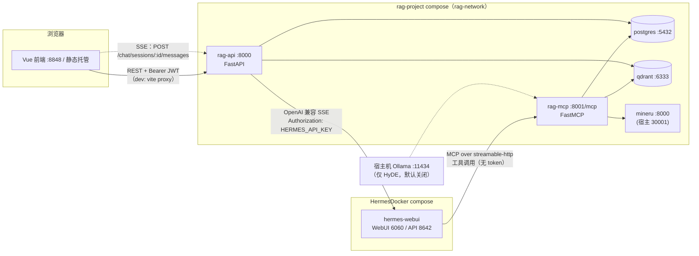

# 架构总览

> 适用状态：2026-10-04。后端 FastAPI + SQLModel + PostgreSQL，前端 Vue3 + Element Plus，知识检索基于 Qdrant，智能问答由 Hermes Agent 经 MCP 工具链完成。
>
> 专题文档：[SQL 表结构](sql表结构.md) ｜ [Web 前端代码设计](web前端代码设计.md) ｜ [Qdrant 解析与召回](qdrant解析与召回.md) ｜ [MCP 工具调用](mcp工具调用.md) ｜ [Excel 数据导入](Excel数据导入.md)

---

# 第一部分　应用部署

## 1.1 服务全景

系统由**两个 Docker Compose 项目、7 个运行容器**组成：

| 容器 | 所属项目 | 技术 | 宿主端口 | 容器内端口 | 职责 |
|---|---|---|---|---|---|
| **rag-api** | rag-project | FastAPI / uvicorn（`--reload`） | 8000 | 8000 | 平台唯一 HTTP 后端：JWT 鉴权、业务 CRUD、Excel 导入、智能问答 SSE 代理 |
| **rag-mcp** | rag-project | FastMCP（streamable-http） | 8001 | 8001 | 给 Hermes Agent 调用的 30 个工具：SQL 台账、Qdrant 知识库、Excel 导入 |
| **postgres** | rag-project | postgres:16-alpine | 5432 | 5432 | 业务库（8 张表） |
| **qdrant** | rag-project | qdrant/qdrant:latest | 6333 / 6334 | 同 | 向量库：6333 HTTP、6334 gRPC |
| **mineru** | rag-project | t300/mineru:0.8.1-paddle-gpu | 30001 | 8000 | GPU PDF 解析（PaddleOCR 版面识别） |
| **hermes-webui** | HermesDocker（独立项目） | ekkoye8888/hermes-web-ui | 6060 | 6060 / **8642** | Hermes Agent：6060 是 WebUI，**8642 是 API Server（仅容器网络内可达）** |
| web（开发态） | 非容器 | Vite dev server | 8848 | — | 开发服务器，proxy 转发到 rag-api:8000 |

说明：

- rag-api 与 rag-mcp 是**同一镜像（`Dockerfile`）、两个独立进程**：rag-api 跑 uvicorn，rag-mcp 跑 `python -m app.mcp.server`，源码均热挂载 `./app:/app/app`。
- 前端生产构建设有 [web/Dockerfile](../web/Dockerfile)（pnpm build → nginx 静态托管），但**当前未纳入 compose 运行**；开发态用 `pnpm dev`（8848）。
- 早期的 Open WebUI、hermes-proxy（nginx iframe 反代，6061）均已移除。

## 1.2 网络拓扑与调用关系



网络：

- **rag-network**：rag-project 自建 bridge，rag-api / rag-mcp / postgres / qdrant / mineru 全部接入。
- **shared-rag**：`external: true` 跨项目网络，rag-api、rag-mcp、hermes-webui 三方成员，用容器名互访（`http://rag-mcp:8001/mcp`、`http://hermes-webui:8642`）。首次部署需手工 `docker network create shared-rag`。

**两条核心链路**

1. **平台业务（人 → 页面）**：浏览器 →（vite proxy / 同源）→ rag-api:8000 → PostgreSQL。rag-api 全程 JWT 鉴权，写操作记审计日志。
2. **智能问答（人 → Agent → 数据）**：
   - 浏览器发 SSE 到 rag-api `/chat/sessions/:id/messages`（平台 JWT）；
   - rag-api 落库用户消息后，组装会话历史，以 `HERMES_API_KEY` 透传转发到 `http://hermes-webui:8642/v1/chat/completions`，字节级回传 SSE，结束后落库助手消息；
   - Hermes Agent 在对话中按需以 MCP 客户端身份调用 rag-mcp 的 30 个工具完成查库、查文档、建索引、Excel 导入等操作。

关键边界：**Hermes API Key 只在 rag-api 后端；前端永远拿不到**。MCP 端点本身无鉴权，安全边界是 Docker 网络（不发布到宿主）。

## 1.3 环境变量（.env，模板见 .env.example）

| 分组 | 变量 | 用途 |
|---|---|---|
| PostgreSQL | `PG_USER` / `PG_PASSWORD` / `PG_DB` / `PG_PORT` / `PG_POOL_SIZE` | 业务库账号与连接池；compose 内自动拼 `PG_DSN=postgresql+asyncpg://…@postgres:5432/rag` |
| JWT | `JWT_SECRET` / `JWT_EXPIRE_HOURS` | 平台登录令牌，默认 24h |
| Qdrant | `QDRANT_COLLECTION`（默认 rag_documents，模板为 workFile）、`QDRANT_HOST/PORT`（compose 注入 qdrant:6333） | 向量集合名与连接 |
| 嵌入/重排 | `EMBEDDING_MODEL`（BAAI/bge-m3）、`RERANKER_MODEL`（BAAI/bge-reranker-v2-m3）、`EMBED_DEVICE`（compose 默认 cpu）、`HF_HOME=/app/models` | 本地 HuggingFace 模型 |
| 检索 | `RETRIEVAL_TOP_K`（30）、`RERANK_TOP_K`（5）、`RERANK_BATCH_SIZE`（16）、`RRF_DENSE_WEIGHT` / `RRF_SPARSE_WEIGHT`（1.0）、`HYDE_ENABLED`（false） | 混合检索参数 |
| 解析/切片 | `PDF_PARSER`（mineru）、`CHUNK_SIZE`（512）、`CHUNK_OVERLAP`（50）、`MINERU_TIMEOUT`（600）、`MINERU_PAGE_CHUNK_SIZE`（20）等 | MinerU 分片解析参数 |
| MinerU | `MINERU_HOST=mineru` / `MINERU_PORT=8000` / `BACKEND=pipeline` / `LANG=ch` | compose 注入 |
| LLM | `LLM_PROVIDER`、`API_DEFAULT_BASE` / `API_DEFAULT_MODEL`（deepseek-chat）、`LLM_KEYS`（JSON）、`OLLAMA_HOST/PORT` | 仅 HyDE 假设问题等场景使用；问答主 LLM 在 Hermes 侧配置 |
| Hermes | `HERMES_API_BASE`（默认 `http://hermes-webui:8642`）、`HERMES_API_KEY`（须与 Hermes 侧 `API_SERVER_KEY` 一致） | 问答代理 |
| 其他 | `RAG_API_PORT`（8000）、`RAG_MCP_PORT`（8001）、`RAG_API_KEY`（可选 X-API-Key） | 端口与可选 API Key |

Hermes 侧（`/home/zshay/HermesDocker/.hermes/.env`）须设置：`API_SERVER_ENABLED=true`、`API_SERVER_HOST=0.0.0.0`、`API_SERVER_KEY=<与 rag-api 一致>`，API Server 默认监听 8642，无需在 compose 发布端口。

## 1.4 数据卷与挂载

| 宿主路径 | 容器内路径 | 挂载到 | 内容 |
|---|---|---|---|
| `data/postgres` | `/var/lib/postgresql/data` | postgres | 业务库数据 |
| `data/qdrant` | `/qdrant/storage` | qdrant | 向量、集合元数据 |
| `data/uploads` | `/app/data/uploads` | rag-api、rag-mcp | 上传文件、Excel 台账源（MCP 默认 Excel 路径在此） |
| `data/mineru` | `/app/data/mineru` 与 `/tmp/mineru` | rag-api、rag-mcp、mineru | PDF 解析中间产物，三方共享 |
| `models/` | `/app/models` | rag-api、rag-mcp | HF 缓存：bge-m3、bge-reranker-v2-m3 |
| `models/mineru` | `/opt/models` | mineru | MinerU/PaddleOCR 权重 |
| `/mnt/公司文件/公司内部文件` | `/app/data/ragtemp:ro` | rag-api、rag-mcp | 公司文件索引源（只读） |
| `/mnt/个人文件` | `/app/data/personal:ro` | rag-api、rag-mcp | 个人文件索引源（只读） |

根目录 `企业信息文件/` 存放 4 个台账导入源 Excel（各类企业情况汇总、小场所、厂中厂责任清单、总隐患汇总表）。

## 1.5 部署与运维命令

```bash
# 首次部署
docker network create shared-rag
cp .env.example .env          # 填好 JWT_SECRET / PG 密码 / HERMES_API_KEY 等
docker compose up -d --build

# 日常
docker compose up -d                     # 启动/收敛
docker compose logs -f rag-api           # 跟踪日志
docker compose restart rag-mcp           # 改了 app/ 代码：mcp 需手动重启
# rag-api 带 --reload + 源码挂载，改 Python 代码自动重载，无需重启

# 数据库：迁移随 rag-api 启动自动执行（alembic upgrade head），无独立命令
docker exec -it postgres psql -U rag -d rag

# 健康检查
curl http://localhost:8000/health
curl http://localhost:8001/mcp

# 前端开发
cd web && pnpm dev        # http://localhost:8848，API 经 vite proxy → :8000
```

注意：

- Hermes 连续 3 次连不上 rag-mcp 会进入 parked 状态，需在 Hermes 侧手动 `hermes gateway` 重启。
- `docker compose down` 只停容器，数据保留在 `./data`。

## 1.6 模型与进程说明

- 嵌入（bge-m3 稠密 + BGEM3FlagModel 稀疏）、重排（bge-reranker-v2-m3）全部为**本地模型**，不走外部嵌入服务。
- rag-api 启动时后台预热三模型（非阻塞）；**rag-mcp 不预热，首次工具调用时懒加载**——两个进程各自持有一份模型实例。
- MinerU 解析前会把嵌入/重排模型 offload 到 CPU 释放显存，解析后按需回迁；compose 中两个服务各预留 1 张 GPU。

---

# 第二部分　文件结构

## 2.1 根目录

```
rag-project/
├── app/                     # 后端主工程（rag-api 与 rag-mcp 共用同一套代码）
├── web/                     # 前端工程（Vue3 + Vite + pnpm，详见 Web 前端文档）
├── data/                    # 容器持久化数据（postgres/qdrant/uploads/mineru）
├── models/                  # HuggingFace 模型缓存（bge-m3 / bge-reranker / mineru）
├── 企业信息文件/             # 4 个台账 Excel 导入源
├── deploy/                  # 部署附加配置（当前为空）
├── docs/                    # 现行项目文档（本目录）
├── docker-compose.yml       # rag-project 容器编排（5 个服务）
├── Dockerfile               # rag-api / rag-mcp 共用镜像
├── requirements.txt         # Python 依赖（mcp 包在 Dockerfile 单独装）
├── .env / .env.example      # 环境变量（.env 勿入库）
└── README.md
```

## 2.2 后端 app/

```
app/
├── main.py                  # FastAPI 入口：中间件、router 挂载、启动时迁移+模型预热
├── config.py                # 全局配置（环境变量 → settings）
├── import_docs.py           # 文档批量索引 CLI：python -m app.import_docs --dir ...
│
├── routers/                 # REST 路由层（rag-api 进程，详见各 router）
│   ├── auth.py              #   /auth：登录、当前用户、改密
│   ├── admin.py             #   /admin：账号 CRUD、审计日志查询
│   ├── enterprises.py       #   /enterprises：企业 CRUD、/query 复合筛选、元数据
│   ├── inspections.py       #   /inspection-records：隐患 CRUD、统计、导入、企业重关联
│   ├── factory_in_factory.py#   /factory-in-factory：厂中厂关系 CRUD、导入
│   ├── materials.py         #   /materials：材料登记、索引触发、范围、证据分片
│   ├── chat.py              #   /chat：会话/消息 5 端点 + 问答 SSE 透传 Hermes
│   └── rag.py               #   /、/health、/evidence/{material_id}
│
├── services/                # 业务服务层（按子包组织）
│   ├── svc_Auth/            #   auth_service（JWT/密码）、user_service（staff）、audit_service
│   ├── svc_Common/          #   filter_service（FilterNode 树→SQL WHERE）、filter_helpers（4 表共用样板）
│   ├── svc_Ledger/          #   enterprise / inspection / factory_in_factory / material / dashboard 五个 service
│   └── svc_Import/          #   import_parser（Excel 解析规范化）、import_writer（落库 Writer）、
│                            #     backfill_service（信息池补空）、enterprise_fields（字段白名单/校验）
│
├── db/                      # 数据访问层
│   ├── models.py            #   SQLModel 表定义（8 张表，详见 SQL 表结构文档）
│   ├── database.py          #   异步引擎（asyncpg）+ Session
│   ├── crud.py              #   BaseRepository 通用 CRUD
│   ├── migrate.py           #   alembic upgrade head 封装（启动自动迁移）
│   └── seed.py              #   初始 admin 种子（幂等）
│
├── mcp/                     # rag-mcp 进程全部代码（30 个工具，详见 MCP 工具调用文档）
│   ├── server.py            #   FastMCP("rag-search") 入口，streamable-http :8001/mcp
│   ├── tool_Sql/            #   business.py：6 个台账只读工具
│   ├── tool_mix/            #   excel_import.py（8）+ backfill.py（5）
│   └── tool_Qdrant/         #   tools.py 注册 + handlers.py 实现：11 个知识库工具
│
├── core_Qdrant/             # RAG 核心（解析/索引/召回，详见 Qdrant 文档）
│   ├── parser.py            #   统一解析器（pdf/docx/xlsx/pptx/md/txt）
│   ├── mineru_client.py     #   MinerU HTTP 客户端（大 PDF 分片、OCR 质量检测）
│   ├── indexer.py           #   切片 + 稠密/稀疏向量索引
│   ├── retriever.py         #   双路召回 + RRF 融合 + rerank 重排
│   ├── models.py            #   bge-m3 / bge-reranker 单例加载与显存调度
│   ├── docs_meta.py         #   文档清单/证据分片等只读元数据视图
│   ├── config.py            #   RAG 参数
│   └── __init__.py          #   index_file / index_directory 对外门面
│
└── alembic/                 # （alembic 实际配置在 db/ 下）
```

分层约定：**router 只做参数校验与审计调用 → service 承载业务规则 → db/core_Qdrant 落具体存储**。四个业务表（企业/巡查/厂中厂/材料）共用 filter_service 与导入管道。

## 2.3 前端 web/（摘要）

```
web/src/
├── views/          # 页面：chat / dashboard / enterprises / confined-spaces /
│                   #   hazardous-chemicals / factoryInFactory / inspections /
│                   #   materials / login / system(staff,audit) / error
├── router/         # hash 路由 + 全局登录守卫（modules/ 7 个静态路由模块）
├── layout/         # 侧边栏 + 顶栏 + 多标签页 + lay-content（:key=fullPath 渲染）
├── components/     # Re* 共享组件（ReFilterHeader / ReColumnSettings / ReContactCell 等）
├── composables/    # useChatStream / useHeaderFilters / useColumnPrefs / useColumnDrag
├── api/            # 后端接口封装（与 router 一一对应）
├── utils/http/     # axios 单例（JWT 注入、401 处理）
├── store/          # Pinia：user / permission / multiTags / app / settings / epTheme
├── types/          # 业务类型（chat.ts）
├── directives/  plugins/  config/  style/  assets/
└── main.ts
```

页面与机制细节见 [Web 前端代码设计](web前端代码设计.md)。

## 2.4 不入库 / 可重建目录

- `.env`、`data/`、`models/` 均在 `.gitignore`；模型权重有数 GB，删除后需重新下载。
- `web/node_modules/`、`web/dist/`、`__pycache__/` 均可重建。
